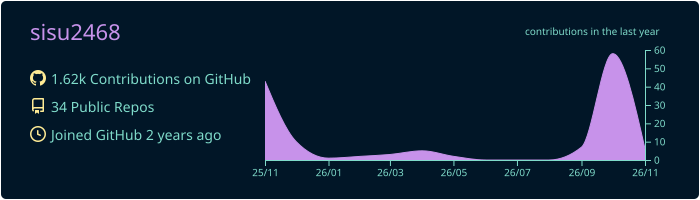
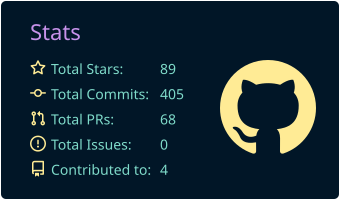
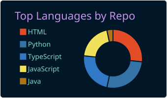
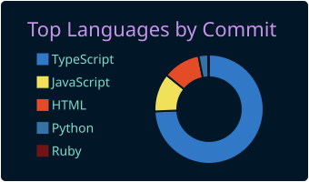
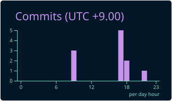

  

<!--
  All cards below are generated by the GitHub Action in
  .github/workflows/profile-summary-cards.yml and committed to this repo,
  so they never depend on a third-party server being online.
-->

  
   
  
  
   
  
  

